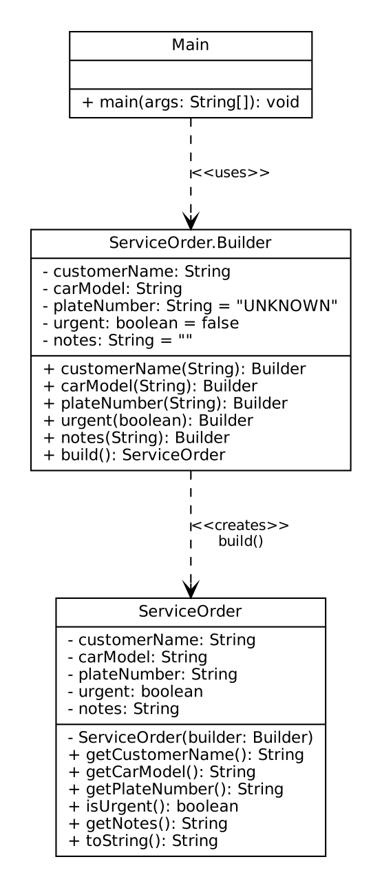
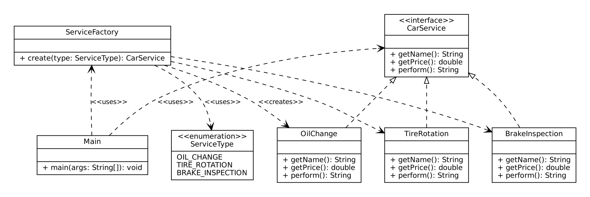
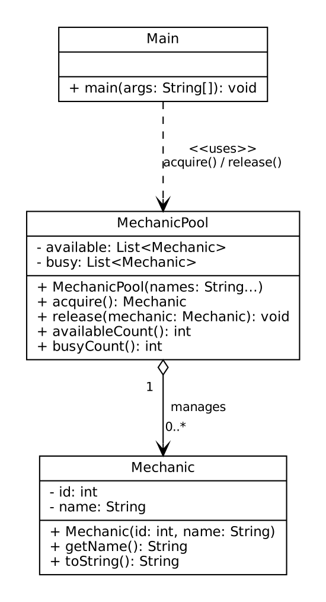

# Laboratory Work Report: Creational Design Patterns Implementation

## Overview

This laboratory work demonstrates the application of Creational Design Patterns (Builder, Factory, Object Pool) in Java through a car service management system. The system accepts service orders, creates the requested service, and assigns the work to a limited set of mechanics.

---

## Design Patterns & Code References

### 1. Builder Pattern

* **Theory:** Builder separates the construction of a complex object from its representation. The object is assembled step by step, which avoids long constructors with many parameters and allows optional fields.
* **Implementation:** `ServiceOrder` has five fields (`customerName`, `carModel`, `plateNumber`, `urgent`, `notes`) and a private constructor, so it can only be created through the nested `Builder` class. The builder sets every field through chained methods, keeps default values for the optional ones (`plateNumber`, `urgent`, `notes`) and creates the immutable order in `build()`.

```java
// ServiceOrder.java
package org.example;

public class ServiceOrder {

    private final String customerName;
    private final String carModel;
    private final String plateNumber;
    private final boolean urgent;
    private final String notes;

    private ServiceOrder(Builder builder) {
        this.customerName = builder.customerName;
        this.carModel = builder.carModel;
        this.plateNumber = builder.plateNumber;
        this.urgent = builder.urgent;
        this.notes = builder.notes;
    }

    public static class Builder {
        private String customerName;
        private String carModel;
        private String plateNumber = "UNKNOWN";
        private boolean urgent = false;
        private String notes = "";

        public Builder customerName(String customerName) {
            this.customerName = customerName;
            return this;
        }

        public Builder carModel(String carModel) {
            this.carModel = carModel;
            return this;
        }

        public Builder plateNumber(String plateNumber) {
            this.plateNumber = plateNumber;
            return this;
        }

        public Builder urgent(boolean urgent) {
            this.urgent = urgent;
            return this;
        }

        public Builder notes(String notes) {
            this.notes = notes;
            return this;
        }

        public ServiceOrder build() {
            return new ServiceOrder(this);
        }
    }
}
```

Usage in `Main`:

```java
ServiceOrder order = new ServiceOrder.Builder()
        .customerName(name)
        .carModel(car)
        .plateNumber(plate)
        .urgent(urgent)
        .notes(notes)
        .build();
```


---

### 2. Factory Pattern

* **Theory:** Factory provides a single place for creating objects and hides the concrete classes from the client. The client asks for an object by type and works with it only through an interface.
* **Implementation:** `ServiceFactory.create(ServiceType)` returns a `CarService` (`OilChange`, `TireRotation` or `BrakeInspection`). The `CarService` interface and the `ServiceType` enum are separate files, while the concrete service classes are private inside the factory, so `Main` depends only on the `CarService` interface. A new service can be added without changing the client code.

```java
// CarService.java
package org.example;

public interface CarService {
    String getName();
    double getPrice();
    String perform();
}
```

```java
// ServiceType.java
package org.example;

public enum ServiceType {
    OIL_CHANGE,
    TIRE_ROTATION,
    BRAKE_INSPECTION
}
```

```java
// ServiceFactory.java
package org.example;

public class ServiceFactory {

    private static class OilChange implements CarService {
        public String getName() { return "Oil Change"; }
        public double getPrice() { return 60.0; }
        public String perform() { return "Draining old oil and filling with fresh oil..."; }
    }

    // TireRotation and BrakeInspection are implemented the same way

    public static CarService create(ServiceType type) {
        if (type == ServiceType.OIL_CHANGE) {
            return new OilChange();
        }
        else if (type == ServiceType.TIRE_ROTATION) {
            return new TireRotation();
        }
        else if (type == ServiceType.BRAKE_INSPECTION) {
            return new BrakeInspection();
        }
        else {
            throw new IllegalArgumentException("Unknown service type: " + type);
        }
    }
}
```

Usage in `Main`:

```java
CarService service = ServiceFactory.create(type);
System.out.println(service.perform());
```


---

### 3. Object Pool Pattern

* **Theory:** Object Pool keeps a set of ready-to-use objects. Clients borrow an object, use it, and return it to the pool instead of creating and destroying objects each time. This limits resource usage and avoids repeated creation cost.
* **Implementation:** The garage has a fixed number of mechanics. `MechanicPool` creates the `Mechanic` objects once and stores them in two lists (`available` and `busy`). `acquire()` moves a mechanic to the busy list and returns it, or returns `null` when everyone is busy. `release()` moves the mechanic back to the available list so it can be reused.

```java
// Mechanic.java
package org.example;

public class Mechanic {
    private final int id;
    private final String name;

    public Mechanic(int id, String name) {
        this.id = id;
        this.name = name;
    }

    public String getName() {
        return name;
    }

    @Override
    public String toString() {
        return "Mechanic with id: " + id + " (" + name + ")";
    }
}
```

```java
// MechanicPool.java
package org.example;

import java.util.ArrayList;
import java.util.List;

public class MechanicPool {

    private final List<Mechanic> available = new ArrayList<>();
    private final List<Mechanic> busy = new ArrayList<>();

    public MechanicPool(String... names) {
        for (int i = 0; i < names.length; i++) {
            available.add(new Mechanic(i + 1, names[i]));
        }
    }

    // Returns a free mechanic, or null if everyone is busy
    public Mechanic acquire() {
        if (available.isEmpty()) {
            return null;
        }

        Mechanic mechanic = available.remove(0);
        busy.add(mechanic);
        return mechanic;
    }

    public void release(Mechanic mechanic) {
        if (busy.remove(mechanic)) {
            available.add(mechanic);
        }
    }
}
```

Usage in `Main`:

```java
MechanicPool pool = new MechanicPool("Alex", "John");

Mechanic mechanic = pool.acquire();   // borrow
// ... perform the service ...
pool.release(mechanic);               // return for reuse
```


---

## Why These Patterns Were Selected

| Pattern | Reason for this topic |
| :--- | :--- |
| **Builder** | A service order has many optional details, so step-by-step construction is clearer than a long constructor |
| **Factory** | The garage offers several service types that share one interface and are chosen by the user |
| **Object Pool** | The number of mechanics is limited and they are reused for every job |
| Singleton | Not needed, there is no object that must exist as only one instance |
| Prototype | Not needed, orders are built from user input and not copied from templates |
| Abstract Factory | Not needed, there are no families of related objects to create |

---

## Code Base Mapping

| File | Type | Applied Pattern | Responsibility |
| :--- | :--- | :--- | :--- |
| `ServiceOrder.java` | Class | **Builder** | Immutable service order assembled step by step through `ServiceOrder.Builder` |
| `CarService.java` | Interface | **Factory** | Abstraction shared by all services, the only type the client depends on |
| `ServiceType.java` | Enum | **Factory** | Identifies which service the client requests from the factory |
| `ServiceFactory.java` | Class | **Factory** | Creates `CarService` objects by `ServiceType` and hides concrete service classes |
| `Mechanic.java` | Class | **Object Pool** | Reusable object that is borrowed and returned |
| `MechanicPool.java` | Class | **Object Pool** | Stores a fixed set of mechanics and lends them out with `acquire()` and `release()` |
| `Job.java` | Class | Client helper | Links an order, its service and the assigned mechanic for an active job |
| `Main.java` | Class | Client | Console menu that combines the builder, the factory and the pool |