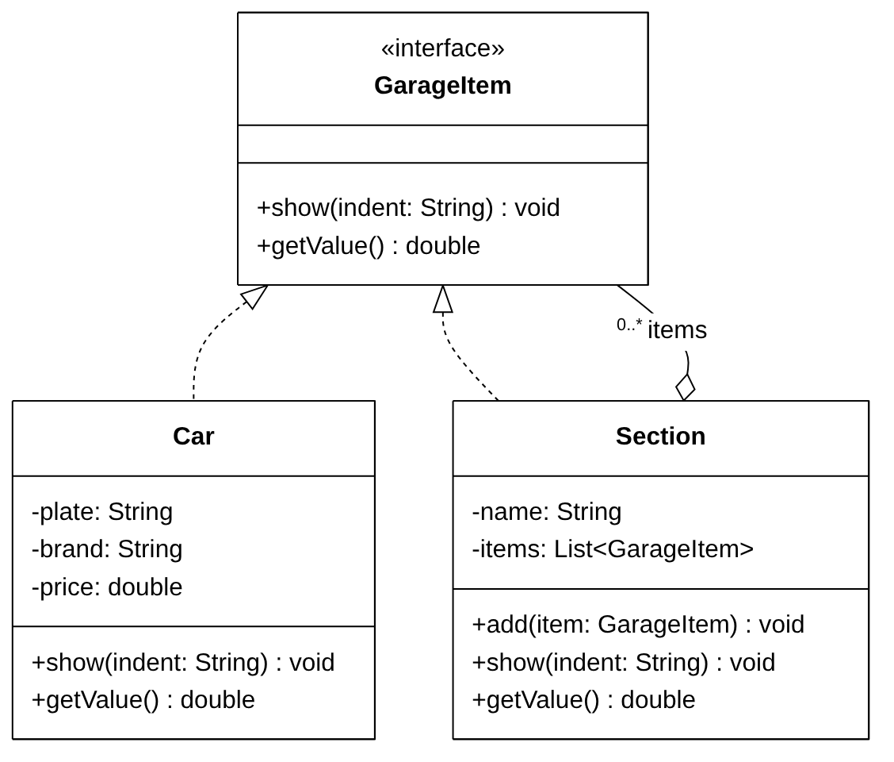
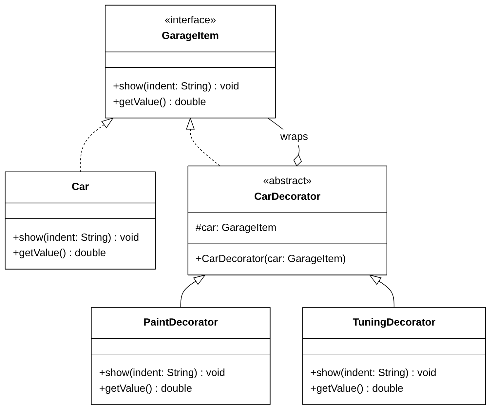
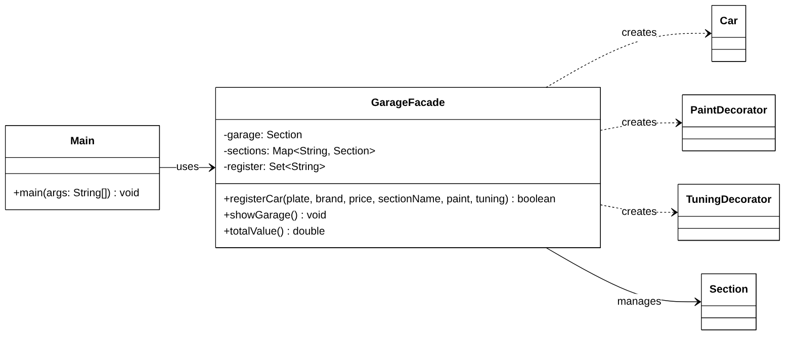

# Laboratory Work Report: Structural Design Patterns Implementation

## Overview

This laboratory work demonstrates the application of Structural Design Patterns (Composite, Decorator, Facade) in Java through a car register and garage system. The system accepts cars from user input, registers them, applies optional upgrades and stores them in garage sections.

---

## Design Patterns & Code References

### 1. Composite Pattern

* **Theory:** Composite arranges objects into a tree structure and lets the client treat a single object and a group of objects in the same way. Both implement one common interface, so operations on the whole tree work without checking the type of each element.
* **Implementation:** `GarageItem` is the common interface with `show()` and `getValue()`. `Car` is the leaf: a single car with a plate, a brand and a price. `Section` is the composite: it stores a list of `GarageItem` objects (cars or other sections) and runs `show()` and `getValue()` on each of them. The garage itself is a `Section` that contains the sections, which contain the cars, so one call to `getValue()` on the garage sums the value of every car.

```java
// Component
interface GarageItem {
    void show(String indent);
    double getValue();
}

// Leaf
class Car implements GarageItem {
    private final String plate, brand;
    private final double price;

    Car(String plate, String brand, double price) {
        this.plate = plate;
        this.brand = brand;
        this.price = price;
    }

    public void show(String indent) {
        System.out.println(indent + "- " + brand + " [" + plate + "] = " + getValue() + " EUR");
    }

    public double getValue() { return price; }
}

// Composite
class Section implements GarageItem {
    private final String name;
    private final List<GarageItem> items = new ArrayList<>();

    Section(String name) { this.name = name; }

    void add(GarageItem item) { items.add(item); }

    public void show(String indent) {
        System.out.println(indent + "[" + name + "] total = " + getValue() + " EUR");
        for (GarageItem item : items) item.show(indent + "   ");
    }

    public double getValue() {
        double sum = 0;
        for (GarageItem item : items) sum += item.getValue();
        return sum;
    }
}
```

Usage in `GarageFacade`:

```java
sections.computeIfAbsent(sectionName, n -> {
    Section s = new Section(n);
    garage.add(s);
    return s;
}).add(car);
```


---

### 2. Decorator Pattern

* **Theory:** Decorator adds new behavior to an object by wrapping it in another object with the same interface. It is an alternative to subclassing: features can be added at runtime and combined in any order, without changing the original class.
* **Implementation:** `CarDecorator` is an abstract class that implements `GarageItem` and holds a reference to the wrapped item. `PaintDecorator` adds a custom paint (+500 EUR) and `TuningDecorator` adds engine tuning (+1200 EUR). Each decorator calls the wrapped object first and then adds its own line to the output and its own price to the value. Because a decorated car is still a `GarageItem`, it can be placed in a `Section` like any other car, and decorators can be stacked.

```java
abstract class CarDecorator implements GarageItem {
    protected final GarageItem car;

    CarDecorator(GarageItem car) { this.car = car; }
}

class PaintDecorator extends CarDecorator {
    PaintDecorator(GarageItem car) { super(car); }

    public void show(String indent) {
        car.show(indent);
        System.out.println(indent + "    + custom paint (+500)");
    }

    public double getValue() { return car.getValue() + 500; }
}

class TuningDecorator extends CarDecorator {
    TuningDecorator(GarageItem car) { super(car); }

    public void show(String indent) {
        car.show(indent);
        System.out.println(indent + "    + engine tuning (+1200)");
    }

    public double getValue() { return car.getValue() + 1200; }
}
```

Usage in `GarageFacade`:

```java
GarageItem car = new Car(plate, brand, price);
if (paint) car = new PaintDecorator(car);
if (tuning) car = new TuningDecorator(car);
```


---

### 3. Facade Pattern

* **Theory:** Facade provides one simple interface to a complex subsystem. The client calls a single method and does not need to know which classes are used behind it, which reduces coupling between the client and the subsystem.
* **Implementation:** `GarageFacade` hides the whole registration process behind `registerCar(...)`. The method checks that the plate is not already in the register, creates the `Car`, wraps it with the chosen decorators, finds or creates the `Section` and adds the car to it. It also offers `showGarage()` and `totalValue()`. `Main` only reads the user input and calls the facade, so it does not depend on `Car`, `Section` or the decorators.

```java
class GarageFacade {
    private final Section garage = new Section("Garage");
    private final Map<String, Section> sections = new HashMap<>();
    private final Set<String> register = new HashSet<>();

    boolean registerCar(String plate, String brand, double price,
                        String sectionName, boolean paint, boolean tuning) {
        if (!register.add(plate)) return false; // already registered

        GarageItem car = new Car(plate, brand, price);
        if (paint) car = new PaintDecorator(car);
        if (tuning) car = new TuningDecorator(car);

        sections.computeIfAbsent(sectionName, n -> {
            Section s = new Section(n);
            garage.add(s);
            return s;
        }).add(car);
        return true;
    }

    void showGarage() { garage.show(""); }

    double totalValue() { return garage.getValue(); }
}
```

Usage in `Main`:

```java
GarageFacade facade = new GarageFacade();

boolean ok = facade.registerCar(plate, brand, price, section, paint, tuning);
System.out.println(ok ? "Car registered!" : "Plate already registered.");
```


---

## Example Run

Input: BMW `MD123`, 10000 EUR, section A, with paint. Audi `MD456`, 8000 EUR, section A, with tuning. Then "Show garage".

```text
[Garage] total = 19700.0 EUR
   [A] total = 19700.0 EUR
      - BMW [MD123] = 10000.0 EUR
          + custom paint (+500)
      - Audi [MD456] = 8000.0 EUR
          + engine tuning (+1200)
```

---

## Why These Patterns Were Selected

| Pattern | Reason for this topic |
| :--- | :--- |
| **Composite** | A garage is a hierarchy (garage, sections, cars), and the total value and the listing must work the same for one car or a whole section |
| **Decorator** | Cars can have optional upgrades (paint, tuning) in any combination, which would need many subclasses without wrapping |
| **Facade** | Registering a car needs several steps in a fixed order, so one entry point keeps `Main` simple |
| Adapter | Not needed, there is no incompatible external interface to convert |
| Bridge | Not needed, there are no two independent hierarchies that must vary separately |
| Flyweight | Not needed, there is no large number of objects with shared state to save memory on |
| Proxy | Not needed, there is no access control, lazy loading or remote object to wrap |

---

## Code Base Mapping

| Class / Interface | Type | Applied Pattern | Responsibility |
| :--- | :--- | :--- | :--- |
| `GarageItem` | Interface | **Composite** | Common component for single cars and groups, with `show()` and `getValue()` |
| `Car` | Class | **Composite** | Leaf: one car with plate, brand and price |
| `Section` | Class | **Composite** | Composite: holds cars or other sections and sums their values |
| `CarDecorator` | Abstract class | **Decorator** | Base wrapper that holds the decorated `GarageItem` |
| `PaintDecorator` | Class | **Decorator** | Adds custom paint (+500 EUR) to a car |
| `TuningDecorator` | Class | **Decorator** | Adds engine tuning (+1200 EUR) to a car |
| `GarageFacade` | Class | **Facade** | Single entry point for registering cars, showing the garage and getting the total value |
| `Main` | Class | Client | Console menu that reads user input and calls only the facade |